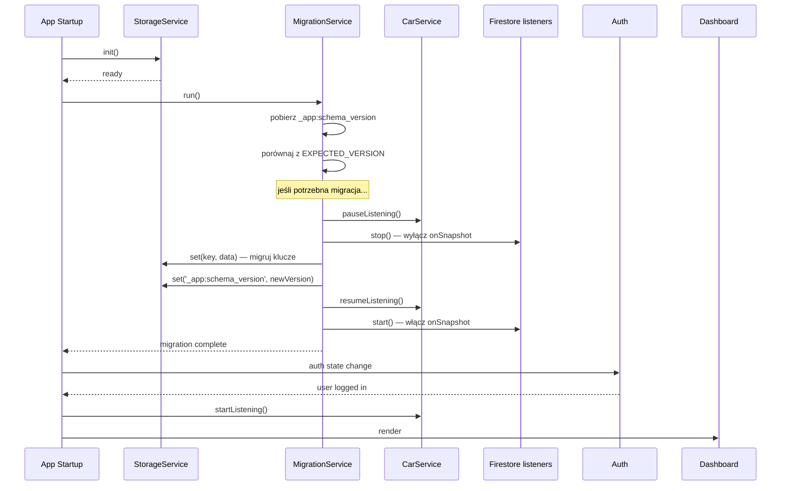

# ADR-003: Inkrementalny system migracji danych lokalnych (Ionic Storage)

- **Status:** accepted
- **Date:** 2026-11-05
- **Deciders:** Architekt (DeepSeek-V4-Pro), PR Reviewer (DeepSeek-V4-Pro)
- **Supersedes:** brak

## Kontekst

Car Manager przechowuje dane w Ionic Storage (IndexedDB) jako lokalne źródło
prawdy. W miarę rozwoju aplikacji modele danych będą ewoluować — dodawane będą
nowe pola (np. `fuelStation` w `Refuel`), zmieniane typy pól, normalizowana
struktura. Obecnie **brak mechanizmu migracji** — aplikacja zakłada, że dane
w storage zawsze pasują do aktualnej wersji interfejsów TypeScript.

Gdy użytkownik zaktualizuje aplikację z danymi w starej strukturze:

- Nowy kod odczyta stare dane → pola będą `undefined`, co może prowadzić do
  `Cannot read property of undefined` lub błędów typów.
- Nowy kod zapisze dane w nowej strukturze → stary kod na innym urządzeniu
  (jeszcze nie zaktualizowanym) nie zrozumie nowych pól.
- SyncService może wysłać do Firestore dane ze starej struktury, tworząc
  niespójność między lokalnym storage a Firestore.

**Kluczowe ograniczenia:**

- Ionic Storage nie wspiera transakcji.
- API jest w pełni asynchroniczne.
- Offline-first: migracja musi działać bez dostępu do sieci.
- Aplikacja jest mała (2-3 osoby), więc rozwiązanie nie musi być przesadnie
  rozbudowane.
- Angular 22: `APP_INITIALIZER` z wieloma providerami (`multi: true`) jest
  uruchamiany **równolegle** (nie sekwencyjnie). Każdy initializer otrzymuje
  własną fabrykę.

## Decyzja

**Wprowadzamy `MigrationService` z inkrementalnym, sekwencyjnym systemem
migracji.** Wersja schematu to prosty rosnący integer (1, 2, 3...),
przechowywany w Ionic Storage pod kluczem `_app:schema_version`. Każda
migracja to osobna funkcja transformująca storage z wersji N na N+1.
Migracje są uruchamiane **po `StorageService.init()` a przed dostępem
do jakichkolwiek danych** — jednym `APP_INITIALIZER` z sekwencyjnym
wywołaniem obu serwisów.

**Nie** wprowadzamy `_schemaVersion` na poziomie pojedynczego rekordu.
Wersjonowanie dotyczy całego schematu storage, nie poszczególnych encji.

### Krytyczne poprawki po review

1. **Guard na ujemny migrationIndex**: Jeśli `storedVersion` jest 0 lub
   inną nieprawidłową wartością, ustawiamy `Math.max(storedVersion ?? 1, 1)`
   i sprawdzamy `migrationIndex >= 0`.

2. **Jeden APP_INITIALIZER**: StorageService.init() i MigrationService.run()
   są wywoływane sekwencyjnie w tej samej fabryce, aby uniknąć race condition
   (Angular uruchamia initializery z `multi: true` równolegle).

3. **Firestore listenery wyłączone podczas migracji**: `MigrationService`
   informuje `CarService`/`RefuelService`/`RepairService` o trwającej
   migracji — listenery Firestore są wstrzymane do czasu zakończenia.

4. **Walidacja typu `_app:schema_version`**: Jeśli wartość pod kluczem nie
   jest `number`, traktujemy jako brak wersji (ustawiamy na 1).

5. **`isRunning` flag**: `MigrationService.run()` jest chronione przed
   równoległym wywołaniem.

6. **Timeout migracji**: Każda migracja ma timeout 30s (`Promise.race`).
   Po przekroczeniu — błąd, wersja niezmieniona, przy następnym starcie
   próba ponowna.

7. **Idempotentność wymuszona**: Każda migracja MUSI być idempotentna.
   Testy automatyczne weryfikują, że dwukrotne uruchomienie migracji
   daje ten sam rezultat.

8. **Walidacja typu wartości**: `typeof storedVersion !== 'number'` jest
   traktowane jako brak wersji (reset do 1).

## Rozważane alternatywy

### Alternatywa 1: Semver dla schematu (np. `1.0.0`)

- **Opis:** Wersja schematu to semver. Migracje z `1.0.0` → `1.1.0` → `2.0.0`.
- **Plusy:** Bardziej ekspresyjne (major/minor/patch). Pozwala rozróżnić
  dodanie pola (minor) od breaking change (major).
- **Minusy:** Nadmiarowe dla małej aplikacji. Semver ma sens gdy wiele osób
  pracuje nad modelem i trzeba koordynować breaking vs non-breaking zmiany.
  Dla 2-3 osobowej aplikacji integer wystarczy.
- **Dlaczego odrzucono:** Zbędna złożoność. Integer w zupełności wystarcza.

### Alternatywa 2: `_modelVersion` na każdym rekordzie

- **Opis:** Każdy `Refuel`, `Repair`, `Car` ma pole `_modelVersion: number`.
  Przy odczycie sprawdzamy wersję i migrujemy pojedynczy rekord w locie.
- **Plusy:** Bardziej granularne — można mieć mieszankę starych i nowych
  rekordów. Nie wymaga migracji całego storage na raz.
- **Minusy:** Każdy odczyt musi sprawdzać wersję i potencjalnie migrować.
  Kod się rozrasta. Trzeba utrzymywać kompatybilność wsteczną dla wszystkich
  wersji. Dla Ionic Storage (brak transakcji) atomowość aktualizacji
  pojedynczego rekordu i tak jest iluzoryczna.
- **Dlaczego odrzucono:** Przedwczesna optymalizacja. Cała baza lokalna
  ma <1000 rekordów — migracja całości przy starcie trwa milisekundy.

### Alternatywa 3: Cloud Functions do migracji Firestore + klient tylko czyta

- **Opis:** Firestore ma triggery/cloud functions, które migrują dane
  po stronie serwera. Klient zawsze dostaje dane w najnowszym formacie.
- **Plusy:** Klient nie musi nic migrować. Spójność danych między
  urządzeniami gwarantowana przez serwer.
- **Minusy:** Wymaga Firebase Blaze plan (płatny). Cloud Functions to
  dodatkowa infrastruktura do utrzymania. Nie rozwiązuje problemu
  offline — klient offline nie dostanie zmigrowanych danych.
- **Dlaczego odrzucono:** Nie akceptowalny koszt i złożoność dla tej skali
  aplikacji. Aplikacja działa na Spark planie (free tier).

## Konsekwencje

### Pozytywne

- Każda przyszła zmiana modelu ma jasną ścieżkę: dodaj migrację, inkrementuj
  `EXPECTED_VERSION`, gotowe.
- Migracje są testowalne w izolacji — każda to czysta funkcja
  `(storage: StorageService) => Promise<void>`.
- Startup aplikacji jest świadomy stanu storage — jeśli wersja storage >
  oczekiwana (użytkownik cofnął update?), aplikacja pokaże komunikat zamiast
  crashować.
- Migracje są idempotentne z definicji (wykonują się tylko raz: gdy
  `storedVersion < EXPECTED_VERSION`).
- `isRunning` + timeout chronią przed równoległym wykonaniem i zawieszeniem.

### Negatywne

- Startup aplikacji jest wolniejszy o czas migracji (zaniedbywalny: ~ms dla
  <1000 rekordów).
- Trzeba pamiętać o dodaniu migracji przy każdej zmianie modelu (dyscyplina
  zespołowa).
- Rollback migracji jest trudny (ale to samo dotyczy każdego systemu migracji
  bez transakcji).
- Jeśli migracja się przerwie (np. crash aplikacji), dane mogą zostać w stanie
  pośrednim — idempotentność minimalizuje ryzyko.

### Neutralne / warte odnotowania

- Firebase Firestore **nie jest migrowany** przez klienta. Klient zawsze czyta
  Firestore przez `onSnapshot` i nadpisuje lokalne dane. Wszystkie nowe pola
  są opcjonalne (`?`), aby stara wersja aplikacji ignorowała nieznane pola.
- Podczas migracji listenery Firestore są wyłączone, aby nie nadpisały
  zmigrowanych danych starymi z Firestore.

## Diagramy

## Powiązane

- [docs/conventions/migrations.md](../conventions/migrations.md) — konwencja
  pisania migracji (do stworzenia przed pierwszą migracją)
- [docs/specs/02-login-screen.md](../specs/02-login-screen.md) — specyfikacja
  offline-first storage wrappera
- PLAN.md — harmonogram prac (Faza 4a: Fundament migracyjny)