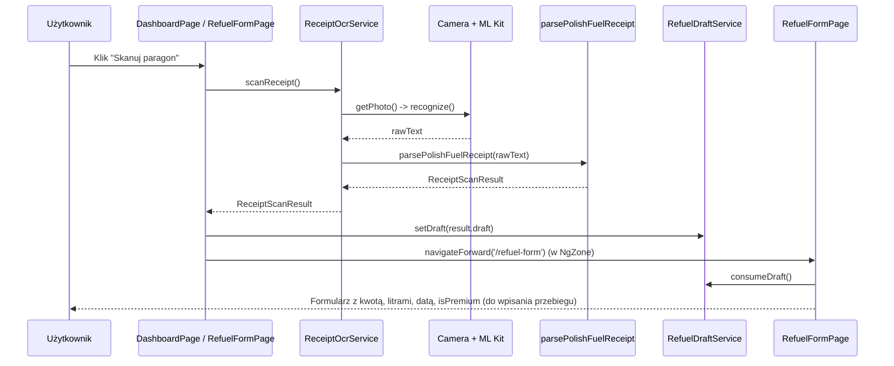

# ADR-004: Lokalny OCR paragonów za tankowanie (ML Kit) oraz ujednolicenie `isPremium`

- **Status:** accepted
- **Date:** 2026-11-25
- **Deciders:** Adam, Architekt AI

## Kontekst

Aplikacja Car Manager jest używana głównie na telefonie (Capacitor 8 / Android) i działa w architekturze offline-first (Ionic Storage + synchronizacja Firestore). Użytkownik potrzebuje wygodnego sposobu na zrobienie zdjęcia paragonu za tankowanie na stacji benzynowej, automatyczne odczytanie podstawowych danych (kwota paliwa, ilość litrów, data, rodzaj paliwa premium) oraz otwarcie wstępnie wypełnionego formularza w celu weryfikacji i ręcznego dopisania przebiegu.

Dodatkowo pole `isVerva` jest zbyt wąskie (sugeruje tylko markę Orlen) i podczas wprowadzania skanera paragonów powinno zostać ujednolicone do ogólnego `isPremium`. Aplikacja znajduje się na etapie testowym bez produkcyjnych danych użytkowników, dlatego wymagana jest prosta i szybka ścieżka bez nadmiarowej infrastruktury ani kodu migracyjnego.

## Decyzja

1. **On-device OCR przez Google ML Kit:** Do przechwytywania zdjęcia i rozpoznawania tekstu wybieramy oficjalne wtyczki kompatybilne z Capacitor 8: `@capacitor/camera` oraz `@capacitor-mlkit/text-recognition`, połączone z czystym, deterministycznym parserem polskich paragonów paliwowych (`parsePolishFuelReceipt`).
2. **Rozdzielenie warstw pod przyszłe rozszerzenia (w tym WebMCP):** Logikę rozpoznawania tekstu zamykamy w serwisie `ReceiptOcrService`, a przekazywanie wstępnie wypełnionych danych do formularza w lekkim serwisie `RefuelDraftService`. Dzięki temu w przyszłości można bez zmian w UI podmienić silnik OCR lub podłączyć narzędzia WebMCP (`document.modelContext`) w wersji PWA.
3. **Czysty rename `isVerva` → `isPremium` bez migracji wstecznej:** Zastępujemy `isVerva` polem `isPremium` bezpośrednio w modelu, serwisach, UI i testach bez rozbudowy systemu migracji (`v1 → v2`) i bez kodu kompatybilności wstecznej w warstwie odczytu Firestore.

## Rozważane alternatywy

### Alternatywa 1: WebMCP (`document.modelContext`) jako główny mechanizm

- **Opis:** Wystawienie narzędzi przeglądarkowych przez WebMCP, aby zewnętrzny agent AI w przeglądarce odczytywał paragon i wypełniał formularz.
- **Plusy:**
  - Ciekawa integracja dla użytkowników korzystających z asystentów AI w przeglądarce desktopowej/mobilnej.
  - Brak własnego kodu OCR po stronie aplikacji.
- **Minusy:**
  - WebMCP samo w sobie nie wykonuje OCR ani nie obsługuje aparatu w aplikacji mobilnej.
  - Brak natywnego wsparcia w Android System WebView / WKWebView używanym przez Capacitor 8.
- **Dlaczego odrzucono:** Nie rozwiązuje głównego scenariusza użytkownika (szybkie zdjęcie telefonem w aplikacji natywnej). Zostało wpisane do `PLAN.md` jako opcjonalne rozszerzenie PWA na przyszłość.

### Alternatywa 2: Firebase AI Logic (`firebase/ai` + Gemini Flash)

- **Opis:** Wysyłanie skompresowanego zdjęcia paragonu do modelu Gemini Flash z ustrukturyzowanym JSON Schema.
- **Plusy:**
  - Bardzo wysoka skuteczność na nietypowych, pogniecionych lub mocno rozbudowanych paragonach.
  - Działa identycznie na Androidzie, iOS i w przeglądarce (PWA).
- **Minusy:**
  - Wymaga połączenia z internetem w chwili skanowania (łamie pełne offline-first).
  - Wymaga dodatkowej konfiguracji usługi chmurowej i zarządzania limitami/kluczami.
- **Dlaczego odrzucono:** Nadmiarowe względem realnych potrzeb (paragony niemal zawsze zawierają samo paliwo, a formularz i tak otwiera się do podglądu). Wydzielenie `ReceiptOcrService` pozwala łatwo dodać ten wariant w przyszłości.

### Alternatywa 3: Tesseract.js (WASM) w warstwie webowej

- **Opis:** Przetwarzanie obrazu w przeglądarce/WebView za pomocą biblioteki JavaScript/WASM.
- **Plusy:**
  - Działa również w przeglądarce bez natywnych wtyczek.
- **Minusy:**
  - Duży rozmiar paczki i plików językowych (`pol.traineddata`).
  - Wolniejsze działanie i niższa jakość rozpoznawania na zdjęciach z aparatu telefonu niż natywny ML Kit.
- **Dlaczego odrzucono:** Gorsze wrażenia na docelowej platformie mobilnej (Android) w porównaniu z natywnym ML Kit.

## Konsekwencje

### Pozytywne

- Skanowanie paragonów działa w 100% offline na urządzeniu, w ułamku sekundy i przy zerowym koszcie API.
- Zdjęcia paragonów nie opuszczają urządzenia i nie wymagają Firebase Storage.
- Czysty rename `isVerva` → `isPremium` utrzymuje bazę kodu prostą, bez martwego kodu migracyjnego.
- `RefuelDraftService` tworzy czysty punkt wejścia dla przyszłego wsparcia WebMCP.

### Negatywne

- Parser regex/heurystyczny dla polskich paragonów wymaga solidnego zestawu testów jednostkowych na różnych formatach stacji (Orlen, Shell, BP, Circle K, Moya).
- W przeglądarce (PWA) funkcja skanowania aparatem z ML Kit nie jest dostępna w pierwszym etapie (przycisk jest ukryty poza platformą natywną).

### Neutralne / warte odnotowania

- Wymaga instalacji `@capacitor/camera` i `@capacitor-mlkit/text-recognition` oraz uruchomienia `npx cap sync` i weryfikacji uprawnień aparatu (`AndroidManifest.xml` / `Info.plist`).
- Istniejące testowe dane lokalne lub w Firestore z polem `isVerva` należy wyczyścić przed testami nowej wersji.

## Diagramy

## Powiązane

- Specyfikacja funkcjonalna: `docs/specs/refuel/03-receipt-ocr.md`
- Roadmapa projektu: `PLAN.md`
- Reguły nawigacji: `docs/conventions/navigation.md`
